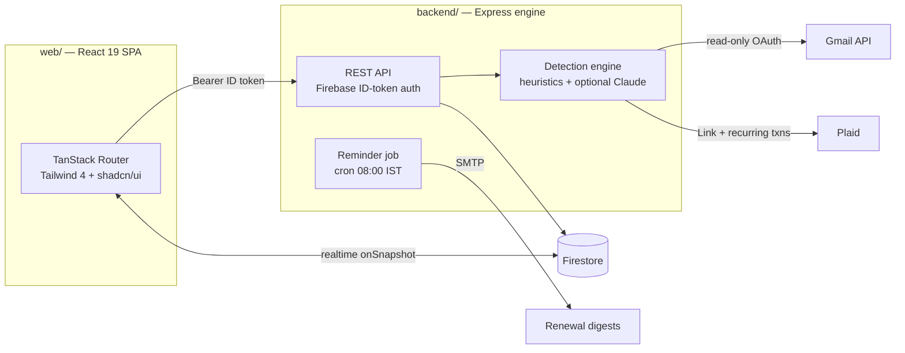

<div align="center">

# Renewly

### Every subscription. One quiet place.


**[renewly.web.app →](https://subscription-hub-19cf9.web.app)**

</div>

---

## Introduction

₹499 here. ₹1,950 there. An annual plan you agreed to eleven months ago and forgot the moment you closed the tab. Subscriptions are built to be forgotten — each one too small to notice on its own, until a bank statement adds them all up for you in one number you didn't see coming.

Renewly does that adding-up first. Connect Gmail — read-only, nothing is ever sent — and it reads the payment receipts and bank-alert emails already sitting in your inbox to work out exactly what you're paying for, tracks the running monthly and yearly cost, and emails you *before* the next renewal lands. Cancelling becomes a decision you make on purpose, not a charge you discover by accident three months later.

It's a full-stack application built end to end for this project: a React SPA, an Express detection engine, real Gmail and bank integrations, a scheduled reminder system, and a deployment that costs nothing to keep running. It is also built India-first — currency, locale, and the entire detection strategy are shaped around how Indian banks and UPI actually notify you of a charge, not retrofitted from a product designed for someone else's banking system.

## Live Demo

**[https://subscription-hub-19cf9.web.app](https://subscription-hub-19cf9.web.app)**

Sign up with any email — the app is fully functional with zero configuration on your end. Bank linking runs against Plaid's Sandbox by default, and Gmail scanning is limited to whichever addresses are registered as test users on the backend (see [Limitations](#limitations)); everything else, including manual tracking, the calendar, reminders, and the cancellation guide, works exactly as it would in production. The backend is hosted on a free tier and may take up to a minute to wake on the first request after a period of inactivity.

## Features

- **Automatic detection from Gmail** — read-only OAuth scan of bank alerts and payment receipts, with MIME parsing, HTML stripping, and marketing-mail filtering so a promotional email is never mistaken for a real charge.
- **Multiple linked inboxes** — connect every Gmail address you use; the same subscription found in two inboxes merges into one entry, tagged with each source address.
- **Weekly background re-scanning** — an incremental scan (only new mail since last time) runs automatically and emails a digest when it finds something new, with an opt-out toggle in Settings.
- **Price-change alerts** — if a scan sees a tracked subscription now billing a different amount, the dashboard flags it; the tracked figure only changes with explicit approval.
- **Bank linking (Plaid Sandbox)** — the same Link-and-consent flow used by apps like Mint, demonstrated end to end against test institutions.
- **Renewal calendar** — a month view of every upcoming charge, with one-click export to a standards-compliant `.ics` file for Google Calendar or any other calendar app.
- **Cancellation guide** — curated cancel steps and a direct link for more than a dozen major services, including the UPI Autopay mandate reminder that most cancellation guides miss.
- **Email reminders** — a daily job emails a digest a configurable number of days before each renewal; overdue dates roll forward automatically.
- **"Till date"** — set an end date on any subscription; once it passes, Renewly asks for permission before retiring it rather than deleting anything silently.
- **Optional AI extraction** — a second detection pass using Claude for emails the regex heuristics can't parse, dormant unless an API key is configured.
- **Complete authentication** — email/password and Google sign-in, password reset, and per-user Firestore security rules enforced server-side.

## Tech Stack

| Layer | Technology |
|---|---|
| Frontend | React 19, Vite 8, TypeScript, Tailwind CSS 4, shadcn/ui, TanStack Router (file-based SPA), Recharts |
| Backend | Node.js, Express, Firebase Admin SDK |
| Auth & Database | Firebase Authentication, Cloud Firestore (realtime) |
| Bank data | Plaid (Link + recurring-transactions API) |
| Email detection | Gmail API (OAuth 2.0, `gmail.readonly`) |
| Optional AI | Anthropic Claude API (structured outputs) |
| Reminders | Nodemailer over Gmail SMTP, node-cron |
| Testing | Jest (backend), Vitest (frontend) |
| Hosting | Firebase Hosting (frontend), Render (backend), cron-job.org (scheduled trigger) |

## Architecture



The frontend talks to Firestore directly for realtime CRUD; the Express engine handles everything that needs server-side secrets — OAuth flows, inbox scanning, Plaid token exchange, and the reminder mailer. Firebase ID tokens authenticate every API call.

```
├── web/                        ← React frontend (Vite SPA)
│   └── src/
│       ├── routes/             ← / (auth) · /dashboard · /calendar · /settings
│       ├── components/         ← AppShell, SubscriptionDialog, shadcn/ui
│       ├── lib/                ← firebase.ts · data.ts · api.ts · types.ts · dedupe.ts · calendar.ts
│       └── hooks/useAuth.tsx
│
├── backend/                    ← Express engine
│   └── src/
│       ├── server.js           ← routes + startup
│       ├── middleware/auth.js  ← Firebase ID-token verification
│       ├── services/
│       │   ├── gmail.js        ← OAuth flow + multi-account inbox scanning
│       │   ├── detector.js     ← recurring-charge heuristics + demo data
│       │   ├── ai.js           ← optional Claude extraction (structured outputs)
│       │   ├── plaid.js        ← Plaid Link + recurring-transactions scanning
│       │   └── mailer.js       ← reminder + digest emails (Nodemailer)
│       └── jobs/
│           ├── reminders.js    ← daily job: roll dates + send digests
│           └── autoscan.js     ← weekly background re-scan
│
├── render.yaml                 ← one-click Render blueprint (free tier)
├── firestore.rules             ← per-user security rules
└── firebase.json               ← hosting serves web/dist
```

## Limitations

Every constraint below is a deliberate tradeoff, not an oversight, and each one is documented here so a reader — technical or not — understands exactly what this app does and does not do, and why.

**Bank connectivity is a demonstration, not a live integration.** Plaid, the bank-linking provider wired into this app, has no coverage in India — it is built for US and European banks — so every connection here runs against Plaid's Sandbox with fake test institutions. This isn't something more code can fix. India's real equivalent is the RBI-regulated Account Aggregator (AA) framework, where a user consents to share bank-statement data through a licensed intermediary such as Setu or OneMoney, the same role Plaid plays for a US bank. Going live on either rail — Plaid in production, or an AA network as a registered Financial Information User — requires a registered business entity and a formal compliance review, which is out of scope for a project built and maintained by one person. What this app demonstrates instead is the complete pattern end to end: the Link modal, the consent flow, the recurring-transaction detection, all proven against real Sandbox data and ready to point at a production provider the day that becomes viable.

**Why detection relies on Gmail — and the real gap even that has.** For an Indian user, Gmail is the closest thing to a genuine, real-time transaction feed available without a business registration: HDFC, ICICI, SBI, and most Indian banks send an email for nearly every card charge and mandate-based debit. Renewly reads those emails, read-only, and reconstructs recurring charges from the pattern of amounts, dates, and merchants. But an inbox is not a bank ledger, and this has one honest blind spot: payments made through UPI apps — Google Pay, PhonePe, Paytm — very often generate no email at all. The bank may send an SMS; the UPI app may show an in-app notification; but nothing reaches Gmail unless the merchant separately chooses to send a receipt. A subscription paid entirely through UPI, with only a product "welcome" email and never a billing one, is invisible to this scanner — not because the detection heuristics are weak, but because there is nothing in the inbox to read. A native Android app reading bank SMS directly, the way a handful of Indian expense trackers historically did, would close this gap — banks SMS a receipt for nearly every UPI debit in real time — but Google Play has restricted the `READ_SMS` permission to default SMS and dialer apps since 2019, making that approach unshippable as a public app. Gmail was the pragmatic choice given that constraint: real, immediate, and requiring no app install, at the cost of missing anything that never generates an email in the first place.

**Gmail access is capped by Google's own policy.** The OAuth app runs in Google's Testing mode, which limits external users to 100 and expires each linked account's access roughly every seven days, requiring a short reconnect. Removing both limits means publishing the app and passing Google's verification for restricted scopes — a multi-week manual review, plus an annual third-party security assessment that costs several hundred to a few thousand dollars a year. That is a real, recurring cost for a portfolio project rather than a commercial product, so the app stays unpublished by deliberate choice.

**AI-assisted extraction is built but left off.** A second detection pass that hands unparseable emails to Claude, with a strict JSON schema and structured outputs, is fully implemented and tested (`backend/src/services/ai.js`). It requires an Anthropic API key to activate and is disabled by default rather than run against a personal budget indefinitely.

**Free-tier hosting trades cost for latency.** The backend runs on Render's free plan, which sleeps after roughly fifteen minutes of inactivity and can take up to a minute to wake on the next request. A scheduled keep-alive ping (see [Deploying](#deploying)) largely mitigates this, but a cold start is still possible on the very first visit after a long idle period.

## Quick Start

Prerequisites: **Node 20+** and **npm**.

```bash
git clone https://github.com/abdullah-habeeb/money-guardian-dash.git
cd money-guardian-dash

# Terminal 1 — backend on :5000
cd backend && npm install && npm run dev

# Terminal 2 — frontend on :3000 (proxies /api to :5000)
cd web && npm install && npm run dev
```

Open **http://localhost:3000**, create an account, and you're in. With zero configuration you get full auth, subscription tracking, charts, and demo-mode Gmail and bank scanning.

```bash
# Tests — 68 backend (Jest) + 45 frontend (Vitest)
cd backend && npm test
cd web && npm test
```

<details>
<summary><b>Docker alternative</b></summary>

```bash
docker-compose up -d --build   # frontend on :80, backend on :5000
```

</details>

## Enabling the Real Integrations

All server configuration lives in `backend/.env` (copy from [backend/.env.example](backend/.env.example)). Each integration is independent — configure what you need, the rest stays in demo mode.

<details>
<summary><b>1 · Real Gmail scanning (Google OAuth)</b></summary>

1. [Google Cloud Console](https://console.cloud.google.com/) → create/select a project.
2. **APIs & Services → Library** → enable the **Gmail API**.
3. **OAuth consent screen** → External → add yourself as a test user.
4. **Credentials → Create credentials → OAuth client ID → Web application** — authorized redirect URI: `http://localhost:5000/api/gmail/callback`
5. In `backend/.env`:
   ```env
   GOOGLE_CLIENT_ID=xxxx.apps.googleusercontent.com
   GOOGLE_CLIENT_SECRET=GOCSPX-xxxx
   ```

Now **Settings → Connect Gmail** runs a real OAuth flow, and **Scan now** reads (read-only) your bank-alert and receipt emails from the last 180 days. Additional addresses can be linked from the same screen; each one must also be added as a test user in step 3.

</details>

<details>
<summary><b>2 · Bank linking (Plaid Sandbox)</b></summary>

1. Sign up free at [dashboard.plaid.com/signup](https://dashboard.plaid.com/signup) — no approval needed for Sandbox.
2. **Team Settings → Keys** → copy your `client_id` and the **Sandbox** `secret`.
3. In `backend/.env`:
   ```env
   PLAID_CLIENT_ID=xxxxxxxxxxxxxxxxxxxxxxxx
   PLAID_SECRET=xxxxxxxxxxxxxxxxxxxxxxxx
   PLAID_ENV=sandbox
   ```

**Settings → Connect bank** now opens the real Plaid Link modal. Use `user_good` / `pass_good` for any test institution — Plaid pre-seeds realistic transaction history, so **Scan now** immediately finds recurring charges.

> **Why Plaid Link instead of a bank username/password form?** Asking users to type bank credentials into a third-party form violates bank terms of service and is a security liability. Plaid — and India's RBI-regulated Account Aggregator framework — exist precisely so an app never sees your bank password. See [Limitations](#limitations) for why this stays in Sandbox for India specifically.

</details>

<details>
<summary><b>3 · Email reminders (Gmail SMTP)</b></summary>

1. Google Account → **Security → 2-Step Verification → App passwords** → create one for "Mail".
2. In `backend/.env`:
   ```env
   SMTP_USER=you@gmail.com
   SMTP_PASS=abcd efgh ijkl mnop   # the app password
   ```

Test it from **Settings → Send me a test reminder**.

</details>

<details>
<summary><b>4 · Daily reminder job (Firebase Admin)</b></summary>

1. [Firebase Console](https://console.firebase.google.com/) → Project settings → **Service accounts** → Generate new private key.
2. Save as `backend/serviceAccountKey.json` (gitignored), then in `backend/.env`:
   ```env
   FIREBASE_SERVICE_ACCOUNT_FILE=./serviceAccountKey.json
   ```

The backend now runs the reminder pass daily at **08:00 IST**, and `POST /api/reminders/run` triggers it externally (guarded by `x-cron-secret` in production). The same daily tick also runs the weekly background auto-scan.

</details>

<details>
<summary><b>5 · AI extraction (Claude)</b></summary>

```env
ANTHROPIC_API_KEY=sk-ant-...
```

That's the whole setup. Gmail scans now run a second pass: emails the heuristics couldn't parse are sent to Claude with a strict JSON schema (structured outputs), and validated candidates merge into the same review queue. Without a key, this code path is never entered.

</details>

## API Reference

All `/api/*` routes (except the OAuth callback) require `Authorization: Bearer <Firebase ID token>`.

| Method | Route | Purpose |
|--------|-------|---------|
| GET | `/health` | Liveness + feature flags (`firestoreAdmin`, `gmailOAuth`, `plaidBank`, `email`, `aiExtraction`) |
| GET | `/api/gmail/status` | Connection state for every linked Gmail address |
| GET | `/api/gmail/auth-url` | Google OAuth consent URL (or `{demo:true}`) |
| GET | `/api/gmail/callback` | OAuth redirect target (Google calls this) |
| POST | `/api/gmail/scan` | Scan every linked inbox → subscription candidates |
| POST | `/api/gmail/disconnect` | Forget one linked address, or all of them |
| GET | `/api/plaid/status` | Bank connection state |
| POST | `/api/plaid/link-token` | Creates a Plaid Link token (or `{demo:true}`) |
| POST | `/api/plaid/exchange` | Exchanges Link's `public_token` for a stored access token |
| POST | `/api/plaid/scan` | Plaid recurring-transactions → subscription candidates |
| POST | `/api/plaid/disconnect` | Revokes and forgets the bank connection |
| POST | `/api/reminders/test` | Email the caller a real reminder now |
| POST | `/api/reminders/run` | Run the daily reminder + auto-scan jobs (header `x-cron-secret` in prod) |

## Deploying

The stack deploys at zero cost: **Firebase Hosting** (frontend, Spark plan) + **Render** (backend, free plan) + **cron-job.org** (external scheduled triggers, since free Render instances sleep when idle).

**1 · Backend → Render.** [render.com](https://render.com) → **New → Blueprint** → pick this repo. Render reads [render.yaml](render.yaml) and creates the `renewly-api` service. In the **Environment** tab, paste the secrets (each key is pre-declared by the blueprint): `FRONTEND_URL`, `FIREBASE_SERVICE_ACCOUNT` (the JSON on one line), `GOOGLE_CLIENT_ID/SECRET`, `GOOGLE_REDIRECT_URI` (`https://<render-url>/api/gmail/callback`), `PLAID_CLIENT_ID/SECRET`, `SMTP_USER/PASS`, `CRON_SECRET`. Then add the production redirect URI to your OAuth client in Google Cloud Console. If Render assigns a different URL than the one in [web/.env.production](web/.env.production), update it and rebuild.

**2 · Frontend → Firebase Hosting.**

```bash
firebase login
cd web && npm run build && cd ..
firebase deploy --only hosting,firestore:rules
```

Deploying `firestore:rules` alongside hosting replaces any permissive test-mode rules (which expire) with the locked-down per-user rules. The `*.web.app` domain is auto-authorized for Firebase Auth.

**3 · Scheduled jobs → cron-job.org.** Free Render instances sleep after roughly fifteen minutes of inactivity, so the in-process cron can't be relied on. Two external jobs keep everything running:

- **Daily digest:** `POST https://<render-url>/api/reminders/run`, daily, custom header `x-cron-secret: <your CRON_SECRET>`.
- **Keep-alive:** `GET https://<render-url>/health`, every 10 minutes — Render's free tier includes enough monthly instance-hours to stay awake continuously, which removes cold starts almost entirely.

> **Free-tier honesty:** without the keep-alive job, a sleeping instance takes up to a minute to wake on the first request. Plaid stays in Sandbox — see [Limitations](#limitations). Gmail OAuth stays in Testing mode for the same reason — see [Limitations](#limitations).

## Roadmap

- **Per-inbox spending graphs** — multiple Gmail accounts already link and scan together; next, break the charts down by which inbox each charge came from.
- **Setu Account Aggregator** — India-native bank linking through the RBI-regulated AA network (free sandbox), making bank scanning real for Indian accounts the way Plaid does internationally.
- **AI extraction by default** — promote the Claude second pass from optional to standard once the project has an API budget.

## Troubleshooting

| Problem | Fix |
|---------|-----|
| Settings says backend isn't reachable | Start it: `cd backend && npm run dev` |
| "Demo mode" on the Gmail / bank cards | Expected without the respective API keys — see [Enabling the Real Integrations](#enabling-the-real-integrations) |
| Plaid Link login fails | Sandbox only accepts `user_good` / `pass_good` ([test credentials](https://plaid.com/docs/sandbox/test-credentials/)) |
| Test reminder says email isn't configured | Set `SMTP_USER` / `SMTP_PASS` (app password, not your real password) |
| Reminder cron disabled at startup | Needs both SMTP config **and** a Firebase service account |
| Firestore `permission-denied` | Deploy the rules: `firebase deploy --only firestore:rules` |
| Google OAuth `redirect_uri_mismatch` | The URI in Google Cloud must exactly match `GOOGLE_REDIRECT_URI` |

---

<div align="center">

**Made by [Abdullah](https://github.com/abdullah-habeeb)** — full-stack subscription tracking with automatic detection and reminders.

</div>
