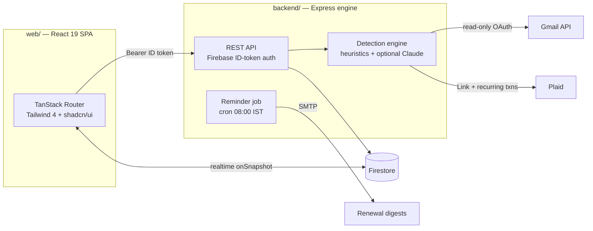

<div align="center">

# 💸 Renewly

### Every subscription. One quiet place.

**Renewly finds the recurring charges hiding in your inbox and bank transactions, tracks what they cost you, and emails you *before* each renewal — so nothing sneaks through.**


</div>

---

## The problem

Subscriptions are designed to be forgotten. The ₹199 here, the ₹1,950 there, the annual renewal you agreed to eleven months ago — they quietly add up to real money. Renewly is a full-stack app that answers three questions:

1. **What am I actually subscribed to?** — detected automatically, not typed in from memory.
2. **What does it all cost?** — monthly and yearly, broken down by category.
3. **What's about to charge me?** — email reminders days before every renewal.

## How detection works

**📬 Gmail scanning is the real-data path.** Indian banks — HDFC, ICICI, SBI and the rest — email you for every debit, autopay, and mandate. Renewly connects to Gmail with **read-only OAuth**, scans your bank alerts and payment receipts, and reconstructs your recurring charges from the paper trail:

- Extracts merchant + amount from alert emails (full MIME parsing, HTML stripping, URL noise removal)
- Filters out marketing mail by header analysis (`List-Unsubscribe`, `Precedence: bulk`) so a "Netflix from ₹149!" promo never becomes a "subscription"
- Infers billing cycles from payment intervals (monthly ≈ 25–35 days, yearly ≈ 350–380 days)
- Proposes candidates with evidence and a confidence score — you approve or dismiss each one

**🏦 Plaid bank linking (international demo).** The same bank-hosted login flow used by Mint and Rocket Money, wired to Plaid's ML-based recurring-transaction detection. Runs on Plaid Sandbox test banks — Plaid doesn't cover India (India uses the RBI Account Aggregator network instead; see [Roadmap](#-roadmap)). Your bank credentials never touch the server: Plaid talks to the bank, the app only receives a token.

**🤖 AI extraction (optional second pass).** With an `ANTHROPIC_API_KEY` configured, billing emails the regex heuristics can't parse are handed to Claude with a strict JSON schema to fit *any* subscription into the `(name, amount, cycle, category, start date)` tuple. Merges with heuristic results; fully dormant without a key.

Both scanners land candidates in **one review queue**, tagged by source. No keys configured? Everything runs in **demo mode** with realistic sample data, so the full flow works on a fresh clone with zero setup.

## ✨ Everything else

- **Dashboard** — monthly/yearly spend, category breakdown chart, upcoming renewals, realtime sync via Firestore `onSnapshot`.
- **Email reminders** — a daily job (08:00 IST cron + an external-trigger endpoint) emails a digest N days before each renewal; you pick N in Settings. Overdue dates roll forward automatically.
- **"Till date"** — set an end date on any subscription; when the final cycle completes, Renewly asks permission before retiring it (keep tracking or remove).
- **Auth done right** — email/password + Google sign-in, forgot-password flow, password visibility toggle, per-user Firestore security rules.
- **Dark, quiet UI** — neutral black/gray theme, shadcn/ui components, count-up animations, empty states that explain themselves.

## 🏗 Architecture



The frontend talks to Firestore directly for realtime CRUD; the Express engine handles everything that needs server-side secrets — OAuth flows, inbox scanning, Plaid token exchange, and the reminder mailer. Firebase ID tokens authenticate every API call.

```
├── web/                        ← React frontend (Vite SPA)
│   └── src/
│       ├── routes/             ← / (auth) · /dashboard · /settings
│       ├── components/         ← AppShell, SubscriptionDialog, shadcn/ui
│       ├── lib/                ← firebase.ts · data.ts · api.ts · types.ts · dedupe.ts
│       └── hooks/useAuth.tsx
│
├── backend/                    ← Express engine
│   └── src/
│       ├── server.js           ← routes + startup
│       ├── middleware/auth.js  ← Firebase ID-token verification
│       ├── services/
│       │   ├── gmail.js        ← OAuth flow + inbox scanning (MIME walk, bulk-mail filter)
│       │   ├── detector.js     ← recurring-charge heuristics + demo data
│       │   ├── ai.js           ← optional Claude extraction (structured outputs)
│       │   ├── plaid.js        ← Plaid Link + recurring-transactions scanning
│       │   └── mailer.js       ← reminder emails (Nodemailer)
│       └── jobs/reminders.js   ← daily job: roll dates + send digests
│
├── render.yaml                 ← one-click Render blueprint (free tier)
├── firestore.rules             ← per-user security rules
└── firebase.json               ← hosting serves web/dist
```

## 🚀 Quick start

Prerequisites: **Node 20+** and **npm**.

```bash
git clone https://github.com/abdullah-habeeb/money-guardian-dash.git
cd money-guardian-dash

# Terminal 1 — backend on :5000
cd backend && npm install && npm run dev

# Terminal 2 — frontend on :3000 (proxies /api to :5000)
cd web && npm install && npm run dev
```

Open **http://localhost:3000**, create an account, and you're in. With zero configuration you get full auth, subscription tracking, charts, and demo-mode Gmail + bank scanning.

```bash
# Tests — 49 backend (Jest) + 20 frontend (Vitest)
cd backend && npm test
cd web && npm test
```

<details>
<summary><b>Docker alternative</b></summary>

```bash
docker-compose up -d --build   # frontend on :80, backend on :5000
```

</details>

## 🔧 Enabling the real integrations

All server configuration lives in `backend/.env` (copy from [backend/.env.example](backend/.env.example)). Each integration is independent — configure what you need, the rest stays in demo mode.

<details>
<summary><b>1 · Real Gmail scanning (Google OAuth)</b></summary>

1. [Google Cloud Console](https://console.cloud.google.com/) → create/select a project.
2. **APIs & Services → Library** → enable the **Gmail API**.
3. **OAuth consent screen** → External → add yourself as a test user.
4. **Credentials → Create credentials → OAuth client ID → Web application** — authorized redirect URI: `http://localhost:5000/api/gmail/callback`
5. In `backend/.env`:
   ```env
   GOOGLE_CLIENT_ID=xxxx.apps.googleusercontent.com
   GOOGLE_CLIENT_SECRET=GOCSPX-xxxx
   ```

Now **Settings → Connect Gmail** runs a real OAuth flow, and **Scan now** reads (read-only) your bank-alert and receipt emails from the last 180 days.

</details>

<details>
<summary><b>2 · Bank linking (Plaid Sandbox)</b></summary>

1. Sign up free at [dashboard.plaid.com/signup](https://dashboard.plaid.com/signup) — no approval needed for Sandbox.
2. **Team Settings → Keys** → copy your `client_id` and the **Sandbox** `secret`.
3. In `backend/.env`:
   ```env
   PLAID_CLIENT_ID=xxxxxxxxxxxxxxxxxxxxxxxx
   PLAID_SECRET=xxxxxxxxxxxxxxxxxxxxxxxx
   PLAID_ENV=sandbox
   ```

**Settings → Connect bank** now opens the real Plaid Link modal. Use `user_good` / `pass_good` for any test institution — Plaid pre-seeds realistic transaction history, so **Scan now** immediately finds recurring charges.

> **Why Plaid Link instead of a bank username/password form?** Asking users to type bank credentials into a third-party form violates bank terms of service and is a security liability. Plaid (and India's RBI-regulated Account Aggregator framework) exist precisely so apps never see your bank password.

</details>

<details>
<summary><b>3 · Email reminders (Gmail SMTP)</b></summary>

1. Google Account → **Security → 2-Step Verification → App passwords** → create one for "Mail".
2. In `backend/.env`:
   ```env
   SMTP_USER=you@gmail.com
   SMTP_PASS=abcd efgh ijkl mnop   # the app password
   ```

Test it from **Settings → Send me a test reminder**.

</details>

<details>
<summary><b>4 · Daily reminder job (Firebase Admin)</b></summary>

1. [Firebase Console](https://console.firebase.google.com/) → Project settings → **Service accounts** → Generate new private key.
2. Save as `backend/serviceAccountKey.json` (gitignored), then in `backend/.env`:
   ```env
   FIREBASE_SERVICE_ACCOUNT_FILE=./serviceAccountKey.json
   ```

The backend now runs the reminder pass daily at **08:00 IST**, and `POST /api/reminders/run` triggers it externally (guarded by `x-cron-secret` in production).

</details>

<details>
<summary><b>5 · AI extraction (Claude)</b></summary>

```env
ANTHROPIC_API_KEY=sk-ant-...
```

That's the whole setup. Gmail scans now run a second pass: emails the heuristics couldn't parse are sent to Claude with a strict JSON schema (structured outputs), and validated candidates merge into the same review queue. Without a key, this code path is never entered.

</details>

## 🌐 API reference

All `/api/*` routes (except the OAuth callback) require `Authorization: Bearer <Firebase ID token>`.

| Method | Route | Purpose |
|--------|-------|---------|
| GET | `/health` | Liveness + feature flags (`firestoreAdmin`, `gmailOAuth`, `plaidBank`, `email`, `aiExtraction`) |
| GET | `/api/gmail/status` | Gmail connection state for the signed-in user |
| GET | `/api/gmail/auth-url` | Google OAuth consent URL (or `{demo:true}`) |
| GET | `/api/gmail/callback` | OAuth redirect target (Google calls this) |
| POST | `/api/gmail/scan` | Scan inbox → subscription candidates |
| POST | `/api/gmail/disconnect` | Forget the stored refresh token |
| GET | `/api/plaid/status` | Bank connection state |
| POST | `/api/plaid/link-token` | Creates a Plaid Link token (or `{demo:true}`) |
| POST | `/api/plaid/exchange` | Exchanges Link's `public_token` for a stored access token |
| POST | `/api/plaid/scan` | Plaid recurring-transactions → subscription candidates |
| POST | `/api/plaid/disconnect` | Revokes and forgets the bank connection |
| POST | `/api/reminders/test` | Email the caller a real reminder now |
| POST | `/api/reminders/run` | Run the daily job (header `x-cron-secret` in prod) |

## 🚢 Deploying — 100% free tier

The stack deploys at zero cost: **Firebase Hosting** (frontend, Spark plan) + **Render** (backend, free plan) + **cron-job.org** (external daily trigger, since free Render instances sleep when idle).

**1 · Backend → Render.** [render.com](https://render.com) → **New → Blueprint** → pick this repo. Render reads [render.yaml](render.yaml) and creates the `renewly-api` service. In the **Environment** tab, paste the secrets (each key is pre-declared by the blueprint): `FRONTEND_URL`, `FIREBASE_SERVICE_ACCOUNT` (the JSON on one line), `GOOGLE_CLIENT_ID/SECRET`, `GOOGLE_REDIRECT_URI` (`https://<render-url>/api/gmail/callback`), `PLAID_CLIENT_ID/SECRET`, `SMTP_USER/PASS`, `CRON_SECRET`. Then add the production redirect URI to your OAuth client in Google Cloud Console. If Render assigns a different URL than the one in [web/.env.production](web/.env.production), update it and rebuild.

**2 · Frontend → Firebase Hosting.**

```bash
firebase login
cd web && npm run build && cd ..
firebase deploy --only hosting,firestore:rules
```

Deploying `firestore:rules` alongside hosting replaces any permissive test-mode rules (which expire!) with the locked-down per-user rules. The `*.web.app` domain is auto-authorized for Firebase Auth.

**3 · Daily reminders → cron-job.org.** Free Render instances sleep after ~15 min idle, so the in-process cron can't be trusted — an external POST both triggers the job and wakes the instance: URL `https://<render-url>/api/reminders/run`, daily at 08:00 IST, custom header `x-cron-secret: <your CRON_SECRET>`.

> **Free-tier honesty:** cold starts take ~50s after sleep (fine for a portfolio, mention it in demos) · Plaid stays in Sandbox (real banks need a Plaid production application) · Gmail OAuth stays in Testing mode (only listed test users can connect — that's you, which is all a portfolio needs).

## 🗺 Roadmap

- **Multiple Gmail accounts per Renewly account** — link several inboxes, track everything together, with per-account breakdowns and charts.
- **Setu Account Aggregator** — India-native bank linking through the RBI-regulated AA network (free sandbox), making bank scanning real for Indian accounts the way Plaid does internationally.
- **AI extraction by default** — promote the Claude second pass from optional to standard once the project has an API budget.

## 🧯 Troubleshooting

| Problem | Fix |
|---------|-----|
| Settings says backend isn't reachable | Start it: `cd backend && npm run dev` |
| "Demo mode" on the Gmail / bank cards | Expected without the respective API keys — see the setup sections above |
| Plaid Link login fails | Sandbox only accepts `user_good` / `pass_good` ([test credentials](https://plaid.com/docs/sandbox/test-credentials/)) |
| Test reminder says email isn't configured | Set `SMTP_USER` / `SMTP_PASS` (app password, not your real password) |
| Reminder cron disabled at startup | Needs both SMTP config **and** a Firebase service account |
| Firestore `permission-denied` | Deploy the rules: `firebase deploy --only firestore:rules` |
| Google OAuth `redirect_uri_mismatch` | The URI in Google Cloud must exactly match `GOOGLE_REDIRECT_URI` |

---

<div align="center">

**Made by [Abdullah](https://github.com/abdullah-habeeb)** — full-stack subscription tracking with automatic detection and reminders.

</div>
